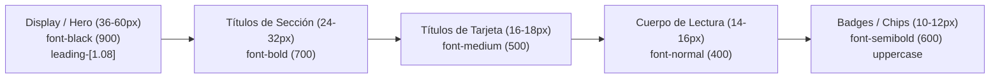

# Sistema de Tokens de Diseño • K’anPro

Documento de especificación oficial de tokens de diseño para la plataforma **K’anPro**, alineado al tema nativo de **shadcn/ui** (`base-rhea`), **Base UI** (`@base-ui/react`) y **Tailwind CSS v4** en el espacio perceptual **OKLCH**.

> [!NOTE]
> Este estándar excluye por completo la paleta legacy `fiord-*`. Todos los componentes y vistas deben apoyarse exclusivamente en los tokens semánticos del sistema (`primary`, `muted`, `accent`, `card`, `border`, etc.).

---

## 1. Configuración de Base & Tailwind CSS v4

La plataforma opera bajo Tailwind v4 con variables CSS en `@theme inline` y compatibilidad con temas dinámicos (`light`, `dark`):

```css
@import "tailwindcss";
@import "tw-animate-css";
@import "shadcn/tailwind.css";

@custom-variant dark (&:is(.dark *));
```

---

## 2. Paleta de Colores Semántica (OKLCH)

### 2.1 Superficies y Elementos Principales

| Token | CSS Variable | Modo Claro (Light) | Modo Oscuro (Dark) | Uso Principal |
| :--- | :--- | :--- | :--- | :--- |
| **Background** | `--background` | `oklch(1 0 0)` | `oklch(0.145 0 0)` | Fondo general del viewport |
| **Foreground** | `--foreground` | `oklch(0.145 0 0)` | `oklch(0.985 0 0)` | Texto de lectura base |
| **Card** | `--card` | `oklch(1 0 0)` | `oklch(0.205 0 0)` | Superficie de tarjetas y módulos |
| **Card Foreground** | `--card-foreground` | `oklch(0.145 0 0)` | `oklch(0.985 0 0)` | Texto dentro de tarjetas |
| **Popover** | `--popover` | `oklch(1 0 0)` | `oklch(0.205 0 0)` | Modales, flyouts, dropdowns |
| **Popover Foreground** | `--popover-foreground` | `oklch(0.145 0 0)` | `oklch(0.985 0 0)` | Texto en menús y popovers |

### 2.2 Roles de Acción y Énfasis

| Token | CSS Variable | Modo Claro (Light) | Modo Oscuro (Dark) | Uso Principal |
| :--- | :--- | :--- | :--- | :--- |
| **Primary** | `--primary` | `oklch(0.5 0.134 242.749)` | `oklch(0.443 0.11 240.79)` | Acciones principales, botones CTA |
| **Primary Foreground** | `--primary-foreground` | `oklch(0.977 0.013 236.62)` | `oklch(0.977 0.013 236.62)` | Texto y pictogramas sobre Primary |
| **Secondary** | `--secondary` | `oklch(0.967 0.001 286.375)` | `oklch(0.274 0.006 286.033)` | Botones y estados secundarios |
| **Secondary Foreground** | `--secondary-foreground` | `oklch(0.21 0.006 285.885)` | `oklch(0.985 0 0)` | Texto sobre color secundario |
| **Muted** | `--muted` | `oklch(0.97 0 0)` | `oklch(0.269 0 0)` | Fondos desactivados, tabs neutros |
| **Muted Foreground** | `--muted-foreground` | `oklch(0.556 0 0)` | `oklch(0.708 0 0)` | Subtítulos, metadatos y placeholders |
| **Accent** | `--accent` | `oklch(0.97 0 0)` | `oklch(0.269 0 0)` | Estados hover en listas y menús |
| **Accent Foreground** | `--accent-foreground` | `oklch(0.205 0 0)` | `oklch(0.985 0 0)` | Texto en estado hover/activo |
| **Destructive** | `--destructive` | `oklch(0.577 0.245 27.325)` | `oklch(0.704 0.191 22.216)` | Errores, descarte, acciones irreversibles |

### 2.3 Contornos y Accesibilidad

| Token | CSS Variable | Modo Claro (Light) | Modo Oscuro (Dark) | Uso Principal |
| :--- | :--- | :--- | :--- | :--- |
| **Border** | `--border` | `oklch(0.922 0 0)` | `oklch(1 0 0 / 10%)` | Separadores y bordes de tarjeta |
| **Input** | `--input` | `oklch(0.922 0 0)` | `oklch(1 0 0 / 15%)` | Contornos de campos de formulario |
| **Ring** | `--ring` | `oklch(0.708 0 0)` | `oklch(0.556 0 0)` | Anillo de foco accesible (`focus-visible`) |

### 2.4 Visualización de Datos (Gráficas / Charts)

| Token | Modo Claro & Modo Oscuro |
| :--- | :--- |
| `--chart-1` | `oklch(0.828 0.111 230.318)` |
| `--chart-2` | `oklch(0.685 0.169 237.323)` |
| `--chart-3` | `oklch(0.588 0.158 241.966)` |
| `--chart-4` | `oklch(0.5 0.134 242.749)` |
| `--chart-5` | `oklch(0.443 0.11 240.79)` |

### 2.5 Barra Lateral de Navegación (`Sidebar`)

| Token | Modo Claro (Light) | Modo Oscuro (Dark) |
| :--- | :--- | :--- |
| `--sidebar` | `oklch(0.985 0 0)` | `oklch(0.205 0 0)` |
| `--sidebar-foreground` | `oklch(0.145 0 0)` | `oklch(0.985 0 0)` |
| `--sidebar-primary` | `oklch(0.588 0.158 241.966)` | `oklch(0.685 0.169 237.323)` |
| `--sidebar-primary-foreground` | `oklch(0.977 0.013 236.62)` | `oklch(0.293 0.066 243.157)` |
| `--sidebar-accent` | `oklch(0.97 0 0)` | `oklch(0.269 0 0)` |
| `--sidebar-accent-foreground` | `oklch(0.205 0 0)` | `oklch(0.985 0 0)` |
| `--sidebar-border` | `oklch(0.922 0 0)` | `oklch(1 0 0 / 10%)` |
| `--sidebar-ring` | `oklch(0.708 0 0)` | `oklch(0.556 0 0)` |

---

## 3. Escala de Radios de Borde (`Border Radius`)

La geometría del sistema K’anPro se caracteriza por esquinas redondeadas generosas y fluidas:

| Token | Expresión CSS | Valor Absoluto | Aplicación Típica |
| :--- | :--- | :--- | :--- |
| `--radius-sm` | `calc(var(--radius) * 0.6)` | **6px** | Tags compactos, micro-tooltips |
| `--radius-md` | `calc(var(--radius) * 0.8)` | **8px** | Checkboxes, selects pequeños |
| `--radius-lg` (`--radius`) | `0.625rem` | **10px** | Inputs, tooltips, modales compactos |
| `--radius-xl` | `calc(var(--radius) * 1.4)` | **14px** | Contenedores medianos, alerts |
| `--radius-2xl` | `calc(var(--radius) * 1.8)` | **18px** | **Botones principales** (`rounded-2xl`) y **Badges** |
| `--radius-3xl` | `calc(var(--radius) * 2.2)` | **22px** | Módulos flotantes y paneles |
| `--radius-4xl` | `calc(var(--radius) * 2.6)` | **26px** | **Tarjetas y Cards** (`rounded-[min(var(--radius-4xl),24px)]`) |

---

## 4. Tipografía y Jerarquía Textual

La plataforma utiliza **Inter** como tipografía Sans-Serif primaria, combinada con la familia **Geist**:

* `--font-sans`: `Inter`, `GeistSans`, system-ui, sans-serif
* `--font-mono`: `GeistMono`, monospace
* `--font-heading`: `var(--font-sans)`



---

## 5. Efectos Especiales y Utilidades Visuales

### 5.1 Glassmorphism (`.glass-card`)

Proporciona efecto de cristal translúcido para tarjetas en modo claro y oscuro:

```css
/* Modo Claro */
.glass-card {
  background: rgba(255, 255, 255, 0.75);
  backdrop-filter: blur(12px);
  -webkit-backdrop-filter: blur(12px);
  border: 1px solid rgba(0, 0, 0, 0.05);
  transition: all 0.3s cubic-bezier(0.4, 0, 0.2, 1);
}

/* Modo Oscuro */
.dark .glass-card {
  background: rgba(20, 20, 25, 0.7);
  border-color: rgba(255, 255, 255, 0.08);
}

/* Interacción Hover */
.glass-card:hover {
  backdrop-filter: blur(16px);
  box-shadow: 0 20px 40px rgba(79, 70, 229, 0.06);
  transform: translateY(-2px);
}
```

### 5.2 Micro-Interacciones de Elevación (`.liquid-card`)

```css
.liquid-card {
  transition: all 0.3s cubic-bezier(0.4, 0, 0.2, 1);
}

.liquid-card:hover {
  transform: translateY(-4px);
  box-shadow: 0 20px 40px rgba(79, 70, 229, 0.08);
}

.dark .liquid-card:hover {
  box-shadow: 0 20px 40px rgba(0, 0, 0, 0.3);
}
```

### 5.3 Tableros Kanban

* Columna estandarizada: `.kanban-column` con `min-width: 320px; max-width: 380px;`.
* Ocultamiento de barra de desplazamiento: `.hide-scrollbar`.

---

## 6. Guía de Reemplazo: Migración de `fiord-*` a Tokens Semánticos

Para retirar de forma limpia la paleta `fiord` en las vistas de candidatos, expedientes y vacantes, se debe aplicar el siguiente mapa de equivalencias:

| Token Legacy | Reemplazo con Token Shadcn | Utilidad Tailwind |
| :--- | :--- | :--- |
| `bg-fiord-50` / `dark:bg-fiord-900/40` | Superficie silenciada secundaria | `bg-muted` o `bg-muted/50` |
| `border-fiord-100` / `border-fiord-200` | Borde estructural estándar | `border-border` |
| `border-fiord-800` | Borde estructural modo oscuro | `border-border` (se adapta automáticamente) |
| `text-fiord-400` / `text-fiord-500` | Texto atenuado / iconos neutros | `text-muted-foreground` |
| `text-fiord-600` / `text-fiord-700` | Texto secundario de lectura | `text-muted-foreground` |
| `text-fiord-900` / `text-fiord-950` | Texto principal de alto contraste | `text-foreground` |
| `bg-fiord-950` / `dark:bg-fiord-100` | Botón o chip de alto contraste | `bg-primary text-primary-foreground` |
| `shadow-soft` | Sombra sutil estándar de tarjeta | `shadow-sm ring-1 ring-foreground/5` |
