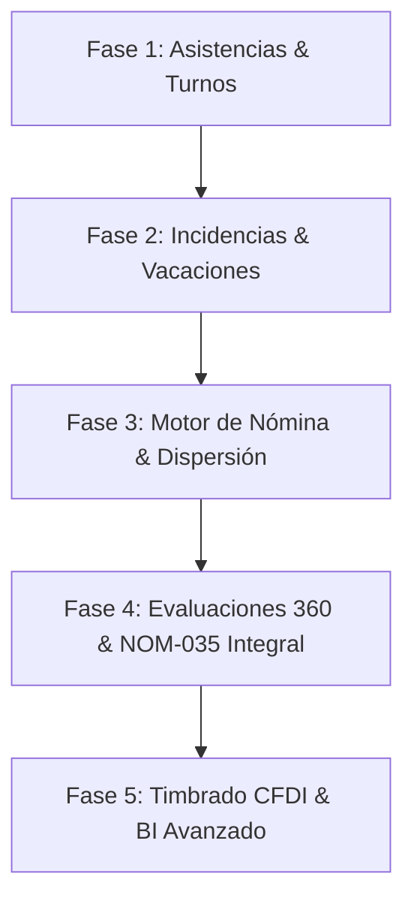

# 📋 K'anPro — Backlog & TO-DO List: Módulo de Empresas

Documento maestro de seguimiento técnico y funcional para las áreas del **Módulo de Empresas** pendientes de finalización e integración profunda.

---

## 📊 Matriz de Estado General

| Módulo / Área | Estado Actual | Prioridad Sugerida | Dependencias Clave |
| :--- | :---: | :---: | :--- |
| **1. Evaluaciones 360 & Desempeño** | 🟡 Parcial (NOM-035 básica) | Media | Catálogo de Áreas, Organigrama |
| **2. Incidencias Laborales** | 🟡 Parcial (CRUD base) | Alta | Portal de Empleado, Motor de Nómina |
| **3. Vacaciones y Permisos** | 🟡 Parcial (Cálculo LFT básico) | Alta | Catálogo de Turnos, Calendario |
| **4. Asistencias y Checador** | 🟡 Parcial (Geocercas base) | Alta | App Móvil / Kiosco, Geocercas |
| **5. Nómina y Pagos** | 🟡 Parcial (Pre-nómina e ISR) | Crítica | Incidencias, Asistencias, PAC/SAT |
| **6. Centro de Reportes** | 🟡 Parcial (CSV básico) | Media | Métricas consolidadas, PDF Engine |

---

## 1. 🎯 Evaluaciones 360, Desempeño y Clima Laboral

### Situación Actual
- Registro manual de competencias básicas (puntualidad, productividad, trabajo en equipo) con cálculo de promedio simple.
- Cuestionarios iniciales de la NOM-035 (Guía I, II y III) en modal.

### Tareas Pendientes (TO-DO)
- [x] **Flujo Multi-Evaluador 360°:**
  - [x] Implementar evaluación multidireccional: Autoevaluación, Evaluación de Pares (colegas), Evaluación de Subordinados y Evaluación de Jefatura.
  - [x] Triangulación de perspectivas en base de datos (`evaluator_relation`).
- [x] **Métricas y Visualización de Talento:**
  - [x] Matriz de Talento 9-Box (Potencial vs. Desempeño) para planes de carrera y sucesión (`NineBoxMatrixView`).
  - [x] Cuadrantes calculados matemáticamente con recomendaciones estratégicas de RH.
- [ ] **Planes de Acción y Seguimiento:**
  - [ ] Módulo de Compromisos y Planes de Desarrollo Individual (PDI) tras la evaluación.
  - [ ] Registro de reuniones de retroalimentación 1 a 1 entre líderes y colaboradores.
- [ ] **Exportación y Reportería:**
  - [ ] Generación de reporte ejecutivo en PDF con semaforización de competencias por departamento.

---

## 2. ⚠️ Incidencias Laborales y Disciplinarias

### Situación Actual
- Tabla de incidencias con severidad (`baja`, `media`, `alta`, `critica`) y categorías predeterminadas.
- Registro administrativo desde el panel de empresa.

### Tareas Pendientes (TO-DO)
- [ ] **Flujo de Notificación y Aceptación:**
  - [ ] Notificación automática en el portal del colaborador cuando se levante una incidencia o reconocimiento.
  - [ ] Sistema de descargo o comentarios por parte del trabajador antes del cierre del acta.
- [ ] **Evidencias y Documentos Oficiales:**
  - [ ] Carga de adjuntos en Supabase Storage (recetas médicas, formatos ST-7 de accidentes de trabajo del IMSS, actas firmadas).
  - [ ] Generador de Acta Administrativa en PDF con formato legal LFT listo para firma digital o física.
- [ ] **Impacto Automático en Nómina y Asistencia:**
  - [ ] Conexión en tiempo real con pre-nómina para deducción de faltas injustificadas y suspensiones.
  - [ ] Regla de negocio para acumulación de retardos (ej. 3 retardos = 1 falta injustificada configurable por empresa).

---

## 3. 🏖️ Vacaciones y Permisos (LFT)

### Situación Actual
- Formulario de solicitud y tabla de aprobaciones/rechazos.
- Utilidad preliminar para cálculo de días hábiles conforme al Art. 76 de la LFT (reforma vacaciones dignas).

### Tareas Pendientes (TO-DO)
- [ ] **Calendario Corporativo de Ausencias:**
  - [ ] Vista interactiva en formato Calendario (semanal / mensual) filtrable por Área o Departamento.
  - [ ] Detección y advertencia de solapamiento de ausencias en puestos críticos de la misma área.
- [ ] **Portal de Autoservicio del Empleado:**
  - [ ] Solicitud de vacaciones directamente desde el perfil del colaborador con visualizador de saldo disponible vs. devengado.
  - [ ] Flujo de aprobación en dos pasos: Vo.Bo. del Líder de Área ➔ Aprobación final de Recursos Humanos.
- [ ] **Políticas y Saldos:**
  - [ ] Gestión de días económicos o permisos especiales (matrimonio, paternidad, luto, estudio).
  - [ ] Cálculo automático de prima vacacional acumulada y fechas de vencimiento de periodo vacacional.
  - [ ] Generación de Constancia Oficial de Disfrute de Vacaciones con acuse de firma del trabajador.

---

## 4. ⏱️ Asistencias y Checador (Control de Acceso)

### Situación Actual
- Configuración de Geocerca (latitud, longitud, radio en metros).
- Lista de marcajes y clasificación preliminar (a tiempo, retardo, inasistencia).

### Tareas Pendientes (TO-DO)
- [ ] **Modos de Checado:**
  - [ ] **Modo Kiosco / Terminal Compartida:** Interfaz para tablet de recepción con QR dinámico por colaborador o PIN de acceso.
  - [ ] **Modo Móvil Geolocalizado:** Marcaje desde el celular del colaborador con comprobación estricta de coordenadas dentro del radio permitido.
  - [ ] **Selfie de Validación (Opcional):** Fotografía de verificación al momento de entrada para evitar suplantaciones de identidad.
- [ ] **Gestión de Horarios y Turnos:**
  - [ ] Catálogo de turnos laborales: Matutino, Vespertino, Nocturno, Mixto y Turnos Especiales (12x36, 24x48).
  - [ ] Asignación de turnos y descansos semanales por empleado o por departamento.
- [ ] **Conciliación y Tiempo Extra:**
  - [ ] Detección automática y autorización de horas extraordinarias (dobles y triples conforme a la LFT).
  - [ ] Módulo de justificación de retardos o salidas tempranas con adjunto de comprobantes.
  - [ ] Cierre y congelación de asistencia semanal/quincenal para pase directo al cálculo de nómina.

---

## 5. 💰 Nómina y Dispersión de Pagos

### Situación Actual
- Desglose básico de pre-nómina quincenal.
- Tablas preliminares de retención de ISR e IMSS obrero.

### Tareas Pendientes (TO-DO)
- [ ] **Motor de Cálculo Salarial Completo (México):**
  - [ ] Cálculo exacto de Salario Diario Integrado (SDI) y Salario Base de Cotización (SBC).
  - [ ] Percepciones adicionales: Vales de despensa, fondo de ahorro, bonos de puntualidad, comisiones.
  - [ ] Deducciones fijas y variables: Préstamos de nómina, amortización Infonavit, cuotas Fonacot, pensiones alimenticias.
  - [ ] Cálculo anual de Aguinaldo, Finiquitos y Liquidaciones conforme a la LFT.
- [ ] **Dispersión Bancaria Masiva:**
  - [ ] Generador de layouts de transferencia bancaria según formato oficial de bancos (BBVA Layout TXT, Citibanamex, Banorte, Santander).
- [x] **Timbrado CFDI de Nómina (SAT 4.0):**
  - [x] Integración con PAC (Proveedor Autorizado de Certificación) para emisión de XML y timbre fiscal (`PacStampingService`).
  - [x] Generación de comprobante CFDI 4.0 con complemento de nómina 1.2 oficial (`sat-cfdi-payroll-generator.ts`).
  - [x] Recibos de nómina con sello digital SAT, UUID fiscal v4 y verificación interactiva con QR oficial SAT.
  - [x] Descarga directa de XML CFDI timbrado y visualización de estatus en portal de nómina.

---

## 6. 📈 Centro de Reportes y Business Intelligence

### Situación Actual
- Visualización de tarjetas KPI generales y botón de descarga a archivo CSV simple.

### Tareas Pendientes (TO-DO)
- [ ] **Generador de Reportes Ejecutivos (PDF & Excel):**
  - [ ] Exportador a PDF con membrete de la empresa, firma de responsables y diseño corporativo listo para imprimir.
  - [ ] Exportador a Excel multi-hoja con fórmulas y estilos estructurados.
- [ ] **Métricas Estratégicas de Recursos Humanos:**
  - [ ] **Índice de Rotación (Turnover):** Altas, bajas, causas de salida y tasa de retención por departamento y por periodo.
  - [ ] **Análisis de Ausentismo y Costos:** Días perdidos por enfermedad general, accidentes de trabajo y costo económico para la empresa.
  - [ ] **Reporte de Costo Laboral Total:** Masa salarial + aportaciones patronales de IMSS, Infonavit y 3% sobre nómina estatal.
- [ ] **Cumplimiento y Auditorías:**
  - [ ] Carpeta digital de inspección STPS (evidencia de contratos firmados, NOM-035, recibos y capacitaciones).
  - [ ] Filtros cruzados avanzados por centro de trabajo, departamento, puesto, fecha y tipo de contrato.
  - [ ] Envío programado de reportes por correo electrónico (semanal/mensual) a la dirección general.

---

## 📌 Recomendación de Fases de Ejecución

